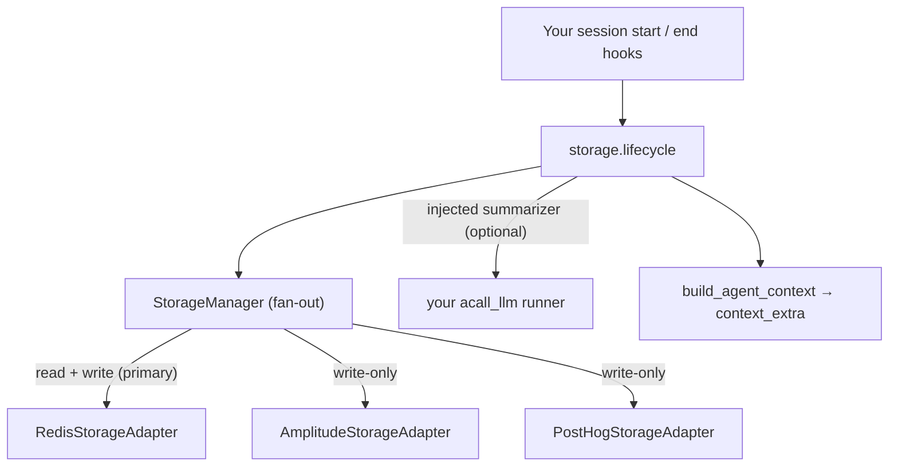

Use **`autoplay_sdk.storage`** to persist a user's [`UserAdoptionState`](/sdk/user-adoption-state) across sessions and to freeze an immutable **session snapshot** at the end of each session. The agent reads this history at the next session start to support the user continuously.

## What it is

Two storage tiers, both behind one pluggable interface:

| Tier | Model | Mutability | Key |
| --- | --- | --- | --- |
| User state | `UserAdoptionState` | Mutable, overwritten each session | `autoplay:user:{product_id}:{user_id}:state` |
| Session snapshot | `SessionSnapshot` | Frozen, **write-once** | `autoplay:user:{product_id}:{user_id}:session:{session_id}` |

The mutable record is the latest view of the user; the immutable snapshots are the durable per-session history the agent reasons over.

<Note>
The SDK never calls an LLM. The onboarding summary is produced by **your** `acall_llm` runner and passed into `on_session_end` (via an injected `summarizer` callable or a pre-computed `summary=`). The SDK ships the versioned prompt (`ONBOARDING_SUMMARY_PROMPT`) and a pure input builder (`build_onboarding_summary_input`); you own the execution.
</Note>

## Architecture



- **`AutoplayStorageAdapter`** — a `Protocol`; implement it to target any destination.
- **`StorageManager`** — fans writes out to every adapter and reads from the first one that returns a value. List your readable primary (Redis) **first**.
- **Adapters** — `RedisStorageAdapter` and `InMemoryStorageAdapter` are built in. The write-only analytics sinks live in `autoplay_sdk.storage.adapters.{amplitude,posthog}`.

## Integration: three steps you own

### 1. Configure adapters once

```python
import os
from autoplay_sdk.storage import StorageManager, RedisStorageAdapter

# Redis must be first — it is the readable primary.
storage = StorageManager([
    RedisStorageAdapter(redis_url=os.environ["REDIS_URL"]),
])
```

Add write-only analytics sinks alongside Redis (needs `pip install "autoplay-sdk[analytics]"`):

```python
from autoplay_sdk.storage.adapters.amplitude import AmplitudeStorageAdapter
from autoplay_sdk.storage.adapters.posthog import PostHogStorageAdapter

storage = StorageManager([
    RedisStorageAdapter(redis_url=os.environ["REDIS_URL"]),  # read + write
    AmplitudeStorageAdapter(api_key=os.environ["AMPLITUDE_API_KEY"]),  # write-only
    PostHogStorageAdapter(api_key=os.environ["POSTHOG_API_KEY"]),      # write-only
])
```

For tests and local dev, swap in `InMemoryStorageAdapter()`.

### 2. On session start — load state and onboarding context

```python
from autoplay_sdk.storage import on_session_start, build_agent_context

state, onboarding_session = await on_session_start(
    product_id="prod_1",
    user_id="u_123",
    session_id="sess_abc",
    storage=storage,
)

# Project into ProactiveTriggerContext.context_extra
context_extra = build_agent_context(state, onboarding_session)
```

`on_session_start` loads the user's state (or initializes a new one), marks the current session, and — for returning users — fetches the onboarding (session 1) snapshot so the agent has continuity.

### 3. On session end — freeze a snapshot and refresh state

The SDK builds the snapshot for you from the live `UserAdoptionState`, so you write near-zero mapping code:

```python
from autoplay_sdk.user_adoption_state import SessionSnapshot
from autoplay_sdk.storage import on_session_end

snapshot = SessionSnapshot.from_adoption_state(
    state,
    session_id="sess_abc",
    session_number=state.sessions_count + 1,
    started_at=session_started_at,          # unix ts you captured at start
    catalog_workflow_ids=["create_project", "invite_team", "configure_columns"],
)

updated = await on_session_end(
    product_id="prod_1",
    user_id="u_123",
    session_snapshot=snapshot,
    storage=storage,
    summarizer=my_summarizer,   # optional; see below
)
```

`on_session_end` writes the snapshot once (a retried session-end can never overwrite it), refreshes the mutable user state, and appends the session to the index.

## The injected summarizer

The SDK ships the prompt and a pure input builder; you run the LLM and hand the result back. This keeps the SDK free of any LLM dependency.

```python
from autoplay_sdk.prompts import ONBOARDING_SUMMARY_PROMPT
from autoplay_sdk.user_adoption_state import build_onboarding_summary_input
from autoplay_sdk.user_adoption_state import SessionSnapshot

async def my_summarizer(snapshot: SessionSnapshot) -> str:
    prompt_input = build_onboarding_summary_input(snapshot)
    content = ONBOARDING_SUMMARY_PROMPT["content"].format(**prompt_input)
    # Run via your standardized acall_llm with prompt metadata:
    text, _meta = await acall_llm(
        model=YOUR_SUMMARY_MODEL,
        messages=[{"role": "system", "content": content}],
        prompt_meta=ONBOARDING_SUMMARY_PROMPT,
    )
    return text
```

Prefer a pre-computed value? Pass `summary="..."` instead of `summarizer=`; it takes precedence. If you pass neither, the summary is simply left unchanged. A summarizer that raises is logged and never loses the session.

## Custom adapters

Any object with the four async methods satisfies the `Protocol` — no inheritance required. The wire boundary is plain JSON dicts (`model.to_dict()`), so your adapter never depends on the SDK's model classes.

```python
from typing import Any

class MyWarehouseAdapter:
    async def save_user_state(self, product_id: str, user_id: str, state: dict[str, Any]) -> None: ...
    async def get_user_state(self, product_id: str, user_id: str) -> dict[str, Any] | None: ...
    async def save_session_snapshot(self, product_id: str, user_id: str, session_id: str, snapshot: dict[str, Any]) -> None: ...
    async def get_session_snapshot(self, product_id: str, user_id: str, session_id: str) -> dict[str, Any] | None: ...
```

Write-only destinations (e.g. analytics) implement the `save_*` methods and return `None` from `get_*`; reads are served by the primary (Redis) adapter.

## Built-in adapters

| Adapter | Import | Reads? | Notes |
| --- | --- | --- | --- |
| `RedisStorageAdapter` | `autoplay_sdk.storage` | Yes | Primary. Needs `autoplay-sdk[redis]`. `SET NX` for snapshots; graceful degradation on Redis errors. |
| `InMemoryStorageAdapter` | `autoplay_sdk.storage` | Yes | Tests / dev only; not shared across processes. |
| `AmplitudeStorageAdapter` | `autoplay_sdk.storage.adapters.amplitude` | No | Write-only. `$identify` for state, `autoplay_session_captured` event for snapshots. Needs `autoplay-sdk[analytics]`. |
| `PostHogStorageAdapter` | `autoplay_sdk.storage.adapters.posthog` | No | Write-only. `$set` for state, `autoplay_session_captured` event for snapshots. Needs `autoplay-sdk[analytics]`. |

Both sinks accept a `property_prefix=` to namespace the properties they write (e.g. `property_prefix="ap"` → `ap_journey_state`).

## Scaling notes

`UserAdoptionState` keeps a bounded inline `sessions_index` (the most recent 50 sessions) plus a monotonic `sessions_count`, so the per-session-start read stays small. Full history is never lost — every session is also its own frozen snapshot key, retrievable by `session_id`.
